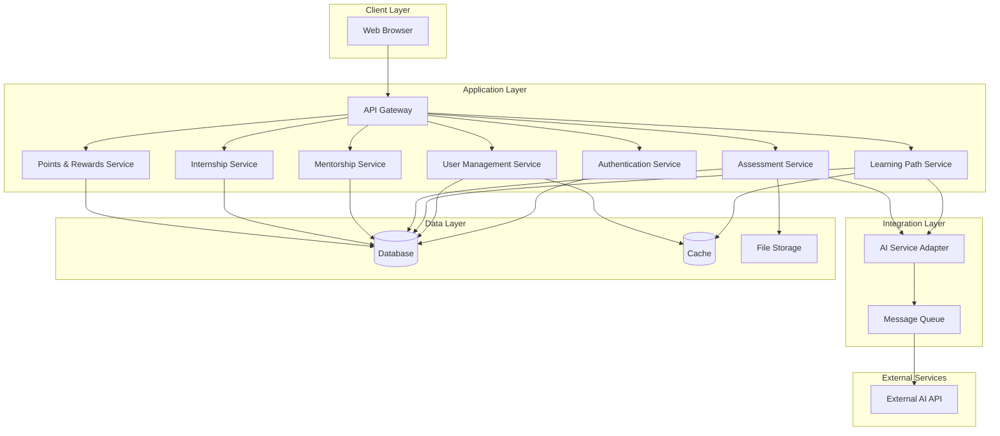

# Design Document: CareerCraft

## Overview

CareerCraft is a web-based AI-driven career and learning platform built using a modern three-tier architecture. The system serves three distinct user roles (Students, Mentors, and Industry Partners) through a responsive web interface, with backend services handling business logic, AI integration, and data persistence. The platform leverages cloud infrastructure for scalability and integrates with external AI services for personalized learning path generation, assessment analysis, and code assistance.

The design prioritizes rapid development for the hackathon prototype while maintaining extensibility for future enhancements. Core architectural decisions include:

- **Serverless/cloud-native approach** for cost efficiency and auto-scaling
- **Role-based access control (RBAC)** for multi-user type management
- **Event-driven architecture** for asynchronous AI processing
- **RESTful API design** for clear separation between frontend and backend
- **Modular component structure** for maintainability

## Architecture

### System Architecture



### Technology Stack Recommendations

**Frontend:**
- React or Vue.js for component-based UI
- Tailwind CSS or Material-UI for responsive design
- Axios for API communication
- Chart.js or Recharts for analytics visualization

**Backend:**
- Node.js with Express or Python with FastAPI
- JWT for authentication tokens
- Serverless functions (AWS Lambda, Google Cloud Functions, or Azure Functions)

**Database:**
- PostgreSQL or MongoDB for primary data storage
- Redis for caching and session management

**AI Integration:**
- OpenAI API, Google Gemini, or similar for learning path generation
- Anthropic Claude or OpenAI for code explanation and debugging

**Infrastructure:**
- Cloud provider (AWS, Google Cloud, or Azure)
- API Gateway for request routing
- Message queue (AWS SQS, Google Pub/Sub, or RabbitMQ) for async processing

## Components and Interfaces

### 1. Authentication Service

**Responsibilities:**
- User registration and login
- Password hashing and validation
- JWT token generation and validation
- Session management
- Role-based access control

**Key Interfaces:**

```typescript
interface AuthService {
  register(email: string, password: string, role: UserRole): Promise<User>
  login(email: string, password: string): Promise<AuthToken>
  validateToken(token: string): Promise<TokenPayload>
  logout(token: string): Promise<void>
  resetPassword(email: string): Promise<void>
}

interface AuthToken {
  accessToken: string
  refreshToken: string
  expiresIn: number
}

interface TokenPayload {
  userId: string
  role: UserRole
  email: string
  iat: number
  exp: number
}
```

### 2. User Management Service

**Responsibilities:**
- Profile creation and updates
- User data retrieval
- Role-specific profile management
- Profile validation

**Key Interfaces:**

```typescript
interface UserManagementService {
  createProfile(userId: string, profileData: ProfileData): Promise<Profile>
  updateProfile(userId: string, updates: Partial<ProfileData>): Promise<Profile>
  getProfile(userId: string): Promise<Profile>
  validateProfile(profile: Profile): ValidationResult
}

interface ProfileData {
  // Student-specific
  degree?: string
  skills?: string[]
  targetCompanies?: string[]
  
  // Mentor-specific
  expertise?: string[]
  experience?: string
  hourlyRate?: number
  availability?: TimeSlot[]
  
  // Industry-specific
  companyName?: string
  industry?: string
  companySize?: string
  location?: string
}
```

### 3. Learning Path Service

**Responsibilities:**
- AI-powered learning path generation
- Task and challenge management
- Progress tracking
- Learning path updates based on performance

**Key Interfaces:**

```typescript
interface LearningPathService {
  generateLearningPath(studentProfile: StudentProfile): Promise<LearningPath>
  updateLearningPath(pathId: string, knowledgeGaps: KnowledgeGap[]): Promise<LearningPath>
  getTasks(studentId: string, filter: TaskFilter): Promise<Task[]>
  completeTask(taskId: string, studentId: string): Promise<TaskCompletion>
  getProgress(studentId: string): Promise<ProgressReport>
}

interface LearningPath {
  id: string
  studentId: string
  goals: string[]
  tasks: Task[]
  estimatedDuration: number
  createdAt: Date
  updatedAt: Date
}

interface Task {
  id: string
  title: string
  description: string
  type: 'daily' | 'weekly' | 'milestone'
  difficulty: 'beginner' | 'intermediate' | 'advanced'
  estimatedTime: number
  dueDate: Date
  status: 'pending' | 'in_progress' | 'completed' | 'overdue'
  points: number
  learningObjectives: string[]
}
```

### 4. Assessment Service

**Responsibilities:**
- Assessment creation and delivery
- Response evaluation
- Knowledge gap analysis using AI
- Assessment history tracking

**Key Interfaces:**

```typescript
interface AssessmentService {
  createAssessment(config: AssessmentConfig): Promise<Assessment>
  submitAssessment(assessmentId: string, responses: Response[]): Promise<AssessmentResult>
  analyzeKnowledgeGaps(result: AssessmentResult): Promise<KnowledgeGap[]>
  getAssessmentHistory(studentId: string): Promise<AssessmentResult[]>
}

interface Assessment {
  id: string
  title: string
  questions: Question[]
  duration: number
  passingScore: number
  skillsAssessed: string[]
}

interface AssessmentResult {
  id: string
  assessmentId: string
  studentId: string
  score: number
  responses: Response[]
  knowledgeGaps: KnowledgeGap[]
  completedAt: Date
}

interface KnowledgeGap {
  skill: string
  severity: 'low' | 'medium' | 'high'
  recommendedActions: string[]
}
```

### 5. Mock Interview & Job Simulation Service

**Responsibilities:**
- Mock interview question generation
- Job simulation task creation
- Response recording and evaluation
- AI-powered feedback generation

**Key Interfaces:**

```typescript
interface InterviewSimulationService {
  startMockInterview(studentId: string, targetCompany: string): Promise<MockInterview>
  submitInterviewResponse(interviewId: string, questionId: string, response: string): Promise<void>
  completeMockInterview(interviewId: string): Promise<InterviewFeedback>
  
  startJobSimulation(studentId: string, jobRole: string): Promise<JobSimulation>
  submitSimulationWork(simulationId: string, submission: Submission): Promise<SimulationResult>
}

interface MockInterview {
  id: string
  studentId: string
  targetCompany: string
  questions: InterviewQuestion[]
  startedAt: Date
}

interface InterviewFeedback {
  overallScore: number
  strengths: string[]
  areasForImprovement: string[]
  questionFeedback: QuestionFeedback[]
  recommendations: string[]
}

interface JobSimulation {
  id: string
  studentId: string
  jobRole: string
  scenario: string
  tasks: SimulationTask[]
  timeLimit: number
}
```

### 6. Code Assistance Service

**Responsibilities:**
- Code explanation using AI
- Debugging assistance
- Multi-language support
- Error identification and fix suggestions

**Key Interfaces:**

```typescript
interface CodeAssistanceService {
  explainCode(code: string, language: string): Promise<CodeExplanation>
  debugCode(code: string, language: string, error?: string): Promise<DebugSuggestions>
  getSupportedLanguages(): string[]
}

interface CodeExplanation {
  summary: string
  lineByLineExplanation: LineExplanation[]
  keyConceptsUsed: string[]
  complexity: string
}

interface DebugSuggestions {
  identifiedIssues: Issue[]
  suggestedFixes: Fix[]
  bestPractices: string[]
}

interface Issue {
  line: number
  severity: 'error' | 'warning' | 'info'
  description: string
  category: string
}
```

### 7. Mentorship Service

**Responsibilities:**
- Mentor profile management
- Session booking and scheduling
- Availability management
- Session feedback collection

**Key Interfaces:**

```typescript
interface MentorshipService {
  createMentorProfile(userId: string, mentorData: MentorData): Promise<MentorProfile>
  updateAvailability(mentorId: string, availability: TimeSlot[]): Promise<void>
  searchMentors(criteria: MentorSearchCriteria): Promise<MentorProfile[]>
  
  bookSession(studentId: string, mentorId: string, timeSlot: TimeSlot): Promise<Session>
  cancelSession(sessionId: string, cancelledBy: string): Promise<void>
  completeSession(sessionId: string): Promise<void>
  submitFeedback(sessionId: string, userId: string, feedback: SessionFeedback): Promise<void>
}

interface Session {
  id: string
  studentId: string
  mentorId: string
  scheduledTime: Date
  duration: number
  status: 'scheduled' | 'in_progress' | 'completed' | 'cancelled'
  meetingLink?: string
  price: number
}

interface MentorProfile {
  userId: string
  expertise: string[]
  experience: string
  hourlyRate: number
  availability: TimeSlot[]
  rating: number
  totalSessions: number
  bio: string
}
```

### 8. Internship Service

**Responsibilities:**
- Internship posting management
- Application submission and tracking
- Candidate matching
- Application review workflow

**Key Interfaces:**

```typescript
interface InternshipService {
  createPosting(industryPartnerId: string, posting: InternshipData): Promise<InternshipPosting>
  updatePosting(postingId: string, updates: Partial<InternshipData>): Promise<InternshipPosting>
  closePosting(postingId: string): Promise<void>
  
  searchInternships(criteria: InternshipSearchCriteria): Promise<InternshipPosting[]>
  applyForInternship(studentId: string, postingId: string): Promise<Application>
  getApplications(postingId: string): Promise<Application[]>
  updateApplicationStatus(applicationId: string, status: ApplicationStatus): Promise<void>
}

interface InternshipPosting {
  id: string
  industryPartnerId: string
  title: string
  description: string
  requirements: string[]
  duration: string
  location: string
  isRemote: boolean
  skillsRequired: string[]
  status: 'active' | 'closed'
  postedAt: Date
}

interface Application {
  id: string
  studentId: string
  postingId: string
  status: 'pending' | 'reviewed' | 'shortlisted' | 'rejected' | 'accepted'
  appliedAt: Date
  studentProfile: StudentProfile
}
```

### 9. Points & Rewards Service

**Responsibilities:**
- Points calculation and awarding
- Rewards and badge management
- Leaderboard generation
- Achievement tracking

**Key Interfaces:**

```typescript
interface PointsRewardsService {
  awardPoints(studentId: string, points: number, reason: string): Promise<PointsTransaction>
  getPointsBalance(studentId: string): Promise<number>
  getPointsHistory(studentId: string): Promise<PointsTransaction[]>
  
  checkAndUnlockRewards(studentId: string): Promise<Reward[]>
  getStudentRewards(studentId: string): Promise<Reward[]>
  getLeaderboard(limit: number): Promise<LeaderboardEntry[]>
}

interface PointsTransaction {
  id: string
  studentId: string
  points: number
  reason: string
  timestamp: Date
}

interface Reward {
  id: string
  name: string
  description: string
  pointsRequired: number
  type: 'badge' | 'feature_unlock' | 'recognition'
  icon: string
}

interface LeaderboardEntry {
  rank: number
  studentId: string
  studentName: string
  totalPoints: number
  rewardsEarned: number
}
```

### 10. AI Service Adapter

**Responsibilities:**
- Abstraction layer for external AI services
- Request queuing and rate limiting
- Error handling and retries
- Response validation and formatting

**Key Interfaces:**

```typescript
interface AIServiceAdapter {
  generateLearningPath(profile: StudentProfile): Promise<LearningPathSuggestion>
  analyzeAssessment(responses: Response[]): Promise<KnowledgeGap[]>
  generateInterviewFeedback(interview: MockInterview, responses: string[]): Promise<InterviewFeedback>
  explainCode(code: string, language: string): Promise<CodeExplanation>
  debugCode(code: string, language: string, error?: string): Promise<DebugSuggestions>
}

interface AIRequest {
  id: string
  type: 'learning_path' | 'assessment' | 'interview' | 'code_explain' | 'code_debug'
  payload: any
  priority: 'high' | 'normal' | 'low'
  retryCount: number
  status: 'queued' | 'processing' | 'completed' | 'failed'
}
```

## Data Models

### User Models

```typescript
// Base User
interface User {
  id: string
  email: string
  passwordHash: string
  role: 'student' | 'mentor' | 'industry_partner'
  createdAt: Date
  lastLogin: Date
  isActive: boolean
}

// Student Profile
interface StudentProfile {
  userId: string
  degree: string
  skills: string[]
  targetCompanies: string[]
  currentLearningPathId?: string
  totalPoints: number
  completedTasks: number
  assessmentsTaken: number
  profileCompleteness: number
}

// Mentor Profile
interface MentorProfile {
  userId: string
  expertise: string[]
  experience: string
  credentials: string[]
  hourlyRate: number
  availability: TimeSlot[]
  bio: string
  profilePhoto?: string
  rating: number
  totalSessions: number
  isVerified: boolean
}

// Industry Partner Profile
interface IndustryPartnerProfile {
  userId: string
  companyName: string
  industry: string
  companySize: string
  location: string
  website?: string
  description: string
  logo?: string
  isVerified: boolean
}
```

### Learning & Assessment Models

```typescript
interface LearningPath {
  id: string
  studentId: string
  goals: string[]
  targetCompanies: string[]
  tasks: Task[]
  milestones: Milestone[]
  estimatedCompletionDate: Date
  progress: number
  createdAt: Date
  updatedAt: Date
}

interface Task {
  id: string
  learningPathId: string
  title: string
  description: string
  type: 'daily' | 'weekly' | 'milestone'
  difficulty: 'beginner' | 'intermediate' | 'advanced'
  skillsTargeted: string[]
  estimatedTime: number
  dueDate: Date
  status: 'pending' | 'in_progress' | 'completed' | 'overdue'
  points: number
  completedAt?: Date
}

interface Assessment {
  id: string
  title: string
  description: string
  questions: Question[]
  duration: number
  passingScore: number
  skillsAssessed: string[]
  difficulty: 'beginner' | 'intermediate' | 'advanced'
  createdAt: Date
}

interface Question {
  id: string
  text: string
  type: 'multiple_choice' | 'coding' | 'short_answer'
  options?: string[]
  correctAnswer: string
  points: number
  explanation: string
}

interface AssessmentResult {
  id: string
  assessmentId: string
  studentId: string
  responses: Response[]
  score: number
  percentage: number
  passed: boolean
  knowledgeGaps: KnowledgeGap[]
  timeSpent: number
  completedAt: Date
}
```

### Mentorship Models

```typescript
interface Session {
  id: string
  studentId: string
  mentorId: string
  scheduledTime: Date
  duration: number
  status: 'scheduled' | 'in_progress' | 'completed' | 'cancelled'
  meetingLink?: string
  price: number
  topic?: string
  notes?: string
  studentFeedback?: SessionFeedback
  mentorFeedback?: SessionFeedback
  createdAt: Date
}

interface SessionFeedback {
  rating: number
  comment: string
  wouldRecommend: boolean
  submittedAt: Date
}

interface TimeSlot {
  dayOfWeek: number
  startTime: string
  endTime: string
  isAvailable: boolean
}
```

### Internship Models

```typescript
interface InternshipPosting {
  id: string
  industryPartnerId: string
  title: string
  description: string
  requirements: string[]
  responsibilities: string[]
  duration: string
  location: string
  isRemote: boolean
  skillsRequired: string[]
  preferredQualifications: string[]
  applicationDeadline: Date
  startDate: Date
  status: 'active' | 'closed' | 'filled'
  postedAt: Date
  updatedAt: Date
}

interface Application {
  id: string
  studentId: string
  postingId: string
  status: 'pending' | 'reviewed' | 'shortlisted' | 'rejected' | 'accepted'
  coverLetter?: string
  appliedAt: Date
  reviewedAt?: Date
  reviewNotes?: string
}
```

### Gamification Models

```typescript
interface PointsTransaction {
  id: string
  studentId: string
  points: number
  reason: string
  category: 'task_completion' | 'assessment' | 'milestone' | 'streak' | 'bonus'
  relatedEntityId?: string
  timestamp: Date
}

interface Reward {
  id: string
  name: string
  description: string
  pointsRequired: number
  type: 'badge' | 'feature_unlock' | 'recognition'
  icon: string
  rarity: 'common' | 'rare' | 'epic' | 'legendary'
}

interface StudentReward {
  studentId: string
  rewardId: string
  unlockedAt: Date
}
```

## Correctness Properties

*A property is a characteristic or behavior that should hold true across all valid executions of a system—essentially, a formal statement about what the system should do. Properties serve as the bridge between human-readable specifications and machine-verifiable correctness guarantees.*


### Property Reflection

After analyzing all acceptance criteria, I've identified several areas where properties can be consolidated:

**Authentication & Profile Management:**
- Properties 1.1 (valid registration) and 1.3 (valid login) both test successful authentication flows
- Properties 2.2 (profile updates) and 11.3 (mentor availability updates) are both round-trip persistence properties
- Can consolidate into general "data persistence" and "authentication success" properties

**Points & Rewards:**
- Property 10.2 (cumulative balance) is an invariant that subsumes individual point awards
- Property 10.1 (award points) is already validated if 10.2 (balance tracking) works correctly

**Notifications:**
- Properties 12.2 (session booking notifications), 9.4 (application status notifications), 14.3 (posting update notifications), and 15.3 (status update notifications) all test the same notification mechanism
- Can consolidate into a single "notification delivery" property

**Data Display:**
- Properties 4.1 (task display), 8.1 (progress reports), 15.2 (application data display) all test that required data fields are present
- Can consolidate into "complete data display" property

**Validation:**
- Properties 2.3 (profile validation), 11.4 (mentor validation), 14.5 (posting validation), 17.4 (password validation) all test input validation
- Can consolidate into general "input validation" properties by category

**AI Service Integration:**
- Properties 22.1-22.4 all relate to AI service reliability and can be combined into comprehensive AI integration properties

After reflection, I'll focus on unique, high-value properties that provide distinct validation coverage.

### Correctness Properties

#### Authentication & Authorization Properties

**Property 1: Valid registration creates accessible accounts**
*For any* valid registration data (unique email, strong password, valid role), creating an account then logging in with those credentials should succeed and grant role-appropriate permissions.
**Validates: Requirements 1.1, 1.3, 1.6**

**Property 2: Invalid credentials are rejected**
*For any* incorrect login credentials or invalid registration data, authentication attempts should be rejected with appropriate error messages.
**Validates: Requirements 1.2, 1.4**

**Property 3: Password security**
*For any* user account, the stored password should be hashed (not plaintext) and should not be retrievable in its original form.
**Validates: Requirements 1.5**

**Property 4: Session timeout enforcement**
*For any* authenticated session, after 30 minutes of inactivity, subsequent requests should be rejected as unauthorized.
**Validates: Requirements 17.2**

**Property 5: Unauthorized access prevention**
*For any* user attempting to access resources outside their role permissions, the system should deny access and log the attempt.
**Validates: Requirements 17.3**

**Property 6: Rate limiting protection**
*For any* sequence of login attempts exceeding the rate limit threshold, subsequent attempts should be throttled or blocked.
**Validates: Requirements 17.5**

#### Data Persistence Properties

**Property 7: Profile data round-trip**
*For any* student profile data (degree, skills, target companies), creating or updating a profile then retrieving it should return equivalent data.
**Validates: Requirements 2.1, 2.2**

**Property 8: Profile validation enforcement**
*For any* profile submission missing required fields (degree or skills), the system should reject it and prevent marking as complete.
**Validates: Requirements 2.3**

**Property 9: Mentor availability round-trip**
*For any* mentor availability update, updating availability then checking the booking system should reflect the changes immediately.
**Validates: Requirements 11.3**

**Property 10: Assessment history persistence**
*For any* completed assessment, storing the result then retrieving assessment history should include that assessment with correct scores and responses.
**Validates: Requirements 5.4**

#### Learning Path Properties

**Property 11: Learning path generation**
*For any* completed student profile, the system should generate a learning path containing daily and weekly tasks aligned with the student's goals.
**Validates: Requirements 3.1, 3.2**

**Property 12: Task organization consistency**
*For any* generated learning path, tasks should be organized by priority and difficulty level in a consistent order.
**Validates: Requirements 3.3**

**Property 13: Learning path reactivity**
*For any* student with identified knowledge gaps, the learning path should be updated to include tasks addressing those gaps.
**Validates: Requirements 3.4, 5.3**

**Property 14: Task status transitions**
*For any* task with a due date, when the current time passes the due date without completion, the task status should transition to "overdue".
**Validates: Requirements 4.4**

**Property 15: Task completion updates progress**
*For any* task completion, the student's progress metrics (completed tasks count, points balance) should increase appropriately.
**Validates: Requirements 4.2, 10.1**

#### Assessment Properties

**Property 16: Assessment scoring consistency**
*For any* assessment submission with the same responses, the calculated score should be identical across multiple evaluations.
**Validates: Requirements 5.1**

**Property 17: Knowledge gap identification**
*For any* completed assessment with incorrect responses, the AI analysis should identify at least one knowledge gap in the relevant skill areas.
**Validates: Requirements 5.2**

#### Mock Interview & Simulation Properties

**Property 18: Interview question relevance**
*For any* student with target companies specified, mock interview questions should relate to those companies' interview patterns or required skills.
**Validates: Requirements 6.1**

**Property 19: Interview response capture**
*For any* mock interview session, all student responses should be recorded and retrievable for feedback generation.
**Validates: Requirements 6.2**

**Property 20: Interview feedback generation**
*For any* completed mock interview, the system should generate feedback including strengths, areas for improvement, and recommendations.
**Validates: Requirements 6.3**

**Property 21: Simulation evaluation completeness**
*For any* job simulation submission, the evaluation should include performance feedback and scoring.
**Validates: Requirements 6.5**

#### Code Assistance Properties

**Property 22: Code explanation generation**
*For any* valid code submission in a supported language, the system should generate an explanation including summary, key concepts, and complexity analysis.
**Validates: Requirements 7.1**

**Property 23: Multi-language support**
*For any* supported programming language, code explanation and debugging should work consistently across all languages.
**Validates: Requirements 7.3**

**Property 24: Debug suggestion generation**
*For any* code submission with errors, the system should identify issues and suggest fixes.
**Validates: Requirements 7.2**

#### Progress & Analytics Properties

**Property 25: Progress report completeness**
*For any* student with activity history, progress reports should include completed tasks, assessment scores, and skill development metrics.
**Validates: Requirements 8.1**

**Property 26: Completion rate calculation**
*For any* student with assigned tasks, the completion rate should equal (completed tasks / total tasks) * 100.
**Validates: Requirements 8.3**

**Property 27: Progress report performance**
*For any* progress report request, the report should be generated and returned within 5 seconds.
**Validates: Requirements 8.5**

#### Internship Properties

**Property 28: Internship search relevance**
*For any* student profile, internship search results should match at least one of the student's skills or target companies.
**Validates: Requirements 9.1**

**Property 29: Internship filtering accuracy**
*For any* filter criteria (company, location, skills, duration), search results should only include postings matching all specified filters.
**Validates: Requirements 9.2**

**Property 30: Application submission**
*For any* valid internship application, the application should appear in the industry partner's dashboard immediately.
**Validates: Requirements 9.3, 15.1**

**Property 31: Duplicate application prevention**
*For any* student and internship posting combination, attempting to apply multiple times should be rejected after the first successful application.
**Validates: Requirements 9.5**

#### Points & Rewards Properties

**Property 32: Points balance invariant**
*For any* student, the cumulative points balance should equal the sum of all points transactions in their history.
**Validates: Requirements 10.2**

**Property 33: Reward unlocking**
*For any* student whose points balance reaches a reward threshold, that reward should be unlocked and appear in their earned rewards list.
**Validates: Requirements 10.3**

**Property 34: Leaderboard ordering**
*For any* leaderboard, students should be ordered by total points in descending order with correct rank assignments.
**Validates: Requirements 10.4**

#### Mentorship Properties

**Property 35: Session booking creation**
*For any* available mentor time slot and student selection, creating a booking should result in a confirmed session with both parties notified.
**Validates: Requirements 12.1, 12.2**

**Property 36: Double-booking prevention**
*For any* mentor time slot, after a successful booking, subsequent booking attempts for the same time slot should be rejected.
**Validates: Requirements 12.4**

**Property 37: Session feedback prompts**
*For any* completed session, both the student and mentor should receive prompts to provide feedback.
**Validates: Requirements 12.5**

#### Industry Partner Properties

**Property 38: Posting validation enforcement**
*For any* internship posting missing required fields (title, description, requirements, duration, location), the system should reject publication.
**Validates: Requirements 14.5**

**Property 39: Posting visibility**
*For any* approved and active internship posting, it should appear in student internship search results.
**Validates: Requirements 14.2**

**Property 40: Application data completeness**
*For any* application displayed to an industry partner, it should include the student's profile, skills, and relevant experience.
**Validates: Requirements 15.2**

**Property 41: Application filtering accuracy**
*For any* filter criteria applied to applications (skills, experience, date), only applications matching the criteria should be displayed.
**Validates: Requirements 15.4**

**Property 42: Status update notifications**
*For any* application status change, the affected student should receive a notification.
**Validates: Requirements 15.3**

#### Performance & Scalability Properties

**Property 43: Response time under load**
*For any* standard operation (page load, data retrieval, form submission), response time should remain under 3 seconds even with increased concurrent users.
**Validates: Requirements 16.1**

#### Security Properties

**Property 44: Data transmission encryption**
*For any* data transmission between client and server, the connection should use HTTPS/TLS encryption.
**Validates: Requirements 17.1**

**Property 45: Password complexity enforcement**
*For any* password submission during registration or password change, passwords not meeting complexity requirements (minimum 8 characters, mixed case, numbers, special characters) should be rejected.
**Validates: Requirements 17.4**

#### AI Service Integration Properties

**Property 46: AI request timeout handling**
*For any* AI service request exceeding 30 seconds, the system should timeout and return an appropriate error message.
**Validates: Requirements 22.1**

**Property 47: AI retry with exponential backoff**
*For any* failed AI service request, the system should retry with exponentially increasing delays between attempts.
**Validates: Requirements 22.2**

**Property 48: AI response validation**
*For any* AI service response, the system should validate the response structure and content before presenting it to users.
**Validates: Requirements 22.4**

**Property 49: AI error handling**
*For any* AI service error, the system should log the error details and display a user-friendly message without exposing technical details.
**Validates: Requirements 22.3**

**Property 50: AI usage throttling**
*For any* AI service usage approaching budget limits, non-critical requests should be throttled or queued.
**Validates: Requirements 19.2**

#### Third-Party API Properties

**Property 51: Graceful degradation**
*For any* third-party API failure, the system should continue operating with core functionality intact, even if some features are temporarily unavailable.
**Validates: Requirements 23.1**

**Property 52: API rate limit compliance**
*For any* third-party API with rate limits, the system should throttle requests to stay within the specified limits.
**Validates: Requirements 23.4**

## Error Handling

### Error Categories

**1. Authentication Errors**
- Invalid credentials
- Expired sessions
- Insufficient permissions
- Account locked/suspended

**Strategy:** Return 401 Unauthorized or 403 Forbidden with clear error messages. Log all authentication failures for security monitoring.

**2. Validation Errors**
- Missing required fields
- Invalid data formats
- Business rule violations
- Duplicate entries

**Strategy:** Return 400 Bad Request with detailed field-level error messages. Validate on both client and server sides.

**3. AI Service Errors**
- Service unavailable
- Request timeout
- Invalid response format
- Rate limit exceeded

**Strategy:** Implement retry logic with exponential backoff. Queue non-critical requests. Provide fallback responses or graceful degradation. Return 503 Service Unavailable with retry-after headers.

**4. Database Errors**
- Connection failures
- Query timeouts
- Constraint violations
- Deadlocks

**Strategy:** Implement connection pooling and retry logic. Use transactions for data consistency. Return 500 Internal Server Error with generic messages (log details internally).

**5. Resource Not Found**
- Invalid IDs
- Deleted resources
- Unauthorized access to existing resources

**Strategy:** Return 404 Not Found. Distinguish between "doesn't exist" and "exists but unauthorized" carefully to avoid information leakage.

**6. Rate Limiting**
- Too many requests
- Quota exceeded

**Strategy:** Return 429 Too Many Requests with retry-after headers. Implement token bucket or sliding window algorithms.

### Error Response Format

All API errors should follow a consistent format:

```typescript
interface ErrorResponse {
  error: {
    code: string
    message: string
    details?: Record<string, any>
    timestamp: string
    requestId: string
  }
}
```

### Logging Strategy

- **Error Level:** System failures, unhandled exceptions, security violations
- **Warning Level:** Degraded functionality, retry attempts, approaching limits
- **Info Level:** Successful operations, state changes, user actions
- **Debug Level:** Detailed execution flow, variable values (development only)

All logs should include:
- Timestamp
- Request ID for tracing
- User ID (when applicable)
- Action/operation
- Result/status
- Duration

### Circuit Breaker Pattern

For external service calls (AI services, third-party APIs):

1. **Closed State:** Normal operation, requests pass through
2. **Open State:** After threshold failures, reject requests immediately
3. **Half-Open State:** After timeout, allow limited requests to test recovery

Configuration:
- Failure threshold: 5 consecutive failures
- Timeout: 60 seconds
- Half-open test requests: 3

## Testing Strategy

### Dual Testing Approach

CareerCraft requires both unit testing and property-based testing for comprehensive coverage:

**Unit Tests** focus on:
- Specific examples demonstrating correct behavior
- Edge cases (empty inputs, boundary values, special characters)
- Error conditions and exception handling
- Integration points between components
- UI component rendering and interactions

**Property-Based Tests** focus on:
- Universal properties that hold for all inputs
- Comprehensive input coverage through randomization
- Invariants that must be maintained
- Round-trip properties (serialize/deserialize, create/retrieve)
- Relationship properties between operations

Both approaches are complementary and necessary - unit tests catch concrete bugs in specific scenarios, while property tests verify general correctness across the input space.

### Property-Based Testing Configuration

**Library Selection:**
- **JavaScript/TypeScript:** fast-check
- **Python:** Hypothesis
- **Java:** jqwik or QuickCheck for Java

**Test Configuration:**
- Minimum 100 iterations per property test (due to randomization)
- Configurable seed for reproducibility
- Shrinking enabled to find minimal failing cases
- Timeout: 30 seconds per property test

**Property Test Tagging:**
Each property-based test must include a comment referencing its design document property:

```typescript
// Feature: careercraft, Property 1: Valid registration creates accessible accounts
test('valid registration allows login with correct permissions', async () => {
  await fc.assert(
    fc.asyncProperty(
      validRegistrationDataGenerator(),
      async (regData) => {
        const user = await authService.register(regData)
        const token = await authService.login(regData.email, regData.password)
        const permissions = await authService.validateToken(token.accessToken)
        
        expect(permissions.role).toBe(regData.role)
        expect(permissions.userId).toBe(user.id)
      }
    ),
    { numRuns: 100 }
  )
})
```

### Test Coverage Requirements

**Unit Test Coverage:**
- Minimum 80% code coverage for business logic
- 100% coverage for authentication and authorization code
- 100% coverage for payment/points calculation logic
- Focus on critical paths and error handling

**Property Test Coverage:**
- At least one property test for each correctness property in this design
- Each property test must reference its property number
- Properties covering data persistence, validation, and calculations are highest priority

### Testing Pyramid

```
    /\
   /  \    E2E Tests (10%)
  /____\   - Critical user journeys
 /      \  - Smoke tests
/________\ Integration Tests (20%)
          \ - API endpoint tests
           \- Service integration tests
            \
             \ Unit & Property Tests (70%)
              - Component logic
              - Business rules
              - Data transformations
```

### Test Data Management

**Generators for Property Tests:**
- Valid user data generator (emails, passwords, roles)
- Profile data generator (skills, companies, degrees)
- Task generator (various types, difficulties, dates)
- Assessment generator (questions, responses, scores)
- Time slot generator (availability, bookings)

**Test Database:**
- Use in-memory database for unit tests
- Use containerized database for integration tests
- Seed data for consistent test scenarios
- Cleanup after each test

### Continuous Integration

**Pre-commit:**
- Linting and formatting checks
- Fast unit tests (<5 seconds)

**Pull Request:**
- All unit tests
- Property-based tests
- Integration tests
- Code coverage report

**Main Branch:**
- Full test suite
- E2E tests
- Performance tests
- Security scans

### Performance Testing

**Load Testing:**
- Simulate 100 concurrent users
- Test response times under load
- Identify bottlenecks

**Stress Testing:**
- Gradually increase load until failure
- Identify breaking points
- Test auto-scaling behavior

**AI Service Testing:**
- Mock AI responses for consistent testing
- Test timeout and retry behavior
- Test queue management under load

## Deployment Architecture

### Cloud Infrastructure

**Recommended Setup (AWS Example):**

```
┌─────────────────────────────────────────────┐
│           CloudFront (CDN)                  │
└─────────────────┬───────────────────────────┘
                  │
┌─────────────────▼───────────────────────────┐
│         S3 (Static Frontend)                │
└─────────────────────────────────────────────┘

┌─────────────────────────────────────────────┐
│         API Gateway                         │
└─────────────────┬───────────────────────────┘
                  │
        ┌─────────┼─────────┐
        │         │         │
┌───────▼──┐ ┌───▼────┐ ┌──▼──────┐
│ Lambda   │ │ Lambda │ │ Lambda  │
│ Auth     │ │ Learn  │ │ Mentor  │
└──────────┘ └────────┘ └─────────┘

┌─────────────────────────────────────────────┐
│         RDS (PostgreSQL)                    │
└─────────────────────────────────────────────┘

┌─────────────────────────────────────────────┐
│         ElastiCache (Redis)                 │
└─────────────────────────────────────────────┘

┌─────────────────────────────────────────────┐
│         SQS (Message Queue)                 │
└─────────────────────────────────────────────┘
```

### Environment Configuration

**Development:**
- Local database
- Mock AI services
- Debug logging enabled
- Hot reload enabled

**Staging:**
- Cloud database (smaller instance)
- Real AI services with lower limits
- Info-level logging
- Mirrors production architecture

**Production:**
- Auto-scaling enabled
- Multi-AZ database
- Full AI service access
- Error-level logging
- Monitoring and alerting

### Security Considerations

**Data Protection:**
- Encryption at rest for database
- Encryption in transit (TLS 1.3)
- Secure credential storage (AWS Secrets Manager, etc.)
- Regular security audits

**Access Control:**
- Principle of least privilege
- Role-based access control
- API key rotation
- IP whitelisting for admin functions

**Compliance:**
- GDPR considerations for user data
- Data retention policies
- Right to deletion implementation
- Privacy policy and terms of service

## Future Considerations

### Scalability Enhancements

1. **Database Sharding:** Partition data by user ID for horizontal scaling
2. **Read Replicas:** Separate read and write operations
3. **Microservices:** Split monolithic services into smaller, independent services
4. **Event Sourcing:** Track all state changes as events for better auditability

### Feature Additions

1. **Real-time Collaboration:** WebSocket support for live mentorship sessions
2. **Video Integration:** Built-in video conferencing for mock interviews
3. **Mobile Apps:** Native iOS and Android applications
4. **Advanced Analytics:** Machine learning for predictive career guidance
5. **Peer Learning:** Student communities and group study features

### Monitoring & Observability

1. **Application Performance Monitoring (APM):** Track request latency, error rates
2. **Distributed Tracing:** Follow requests across services
3. **Custom Metrics:** Track business KPIs (user engagement, completion rates)
4. **Alerting:** Automated alerts for anomalies and failures
